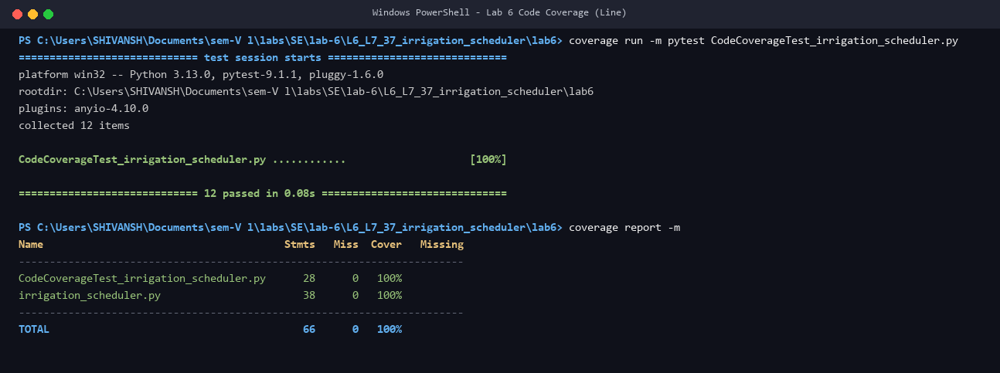
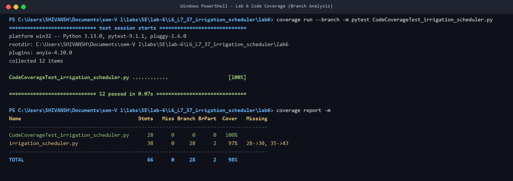
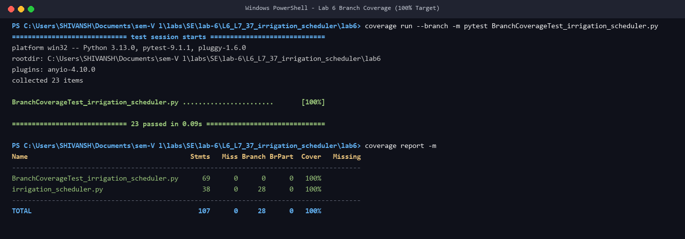

# L6_L7_37 — Irrigation Scheduler

**Lab 6: Code and Branch Coverage Analysis**  
**Student:** Shivansh Sharma (PES2UG24CS474)  
**Course:** Software Engineering (UE22CS341AA)  
**Institution:** PES University, Bengaluru  

---

## Overview

This repository contains the implementation, analysis, and comprehensive test suites for the `irrigation_scheduler` module. The project demonstrates the distinction between **Line (Statement) Coverage** and **Branch (Decision) Coverage** using `pytest` and `coverage.py`.

### Coverage Highlights
- **Baseline Coverage:** 29% statement coverage, 24% branch coverage.
- **Code Coverage Suite:** **100% statement coverage**, 97% branch coverage (exposing untested branches).
- **Branch Coverage Suite:** **100% statement coverage**, **100% branch coverage** (0 missing branches, all 28 decision pathways tested).

---

## Deliverables & File Structure

| Deliverable | File Path | Description |
|---|---|---|
| **Application Under Test** | [`irrigation_scheduler.py`](irrigation_scheduler.py) | Python module for irrigation decisions and scheduling. |
| **Code Coverage Tests** | [`CodeCoverageTest_irrigation_scheduler.py`](CodeCoverageTest_irrigation_scheduler.py)<br>[`CodeCoverageTest_xxxx_application.py`](CodeCoverageTest_xxxx_application.py) | Test cases designed to achieve 100% statement coverage. |
| **Branch Coverage Tests** | [`BranchCoverageTest_irrigation_scheduler.py`](BranchCoverageTest_irrigation_scheduler.py)<br>[`BranchCoverageTest_xxxx_application.py`](BranchCoverageTest_xxxx_application.py) | Comprehensive test cases achieving 100% branch coverage. |
| **Active Test Suite** | [`test_irrigation_scheduler.py`](test_irrigation_scheduler.py) | Updated full test suite covering all branches and edge cases. |
| **Detailed Report** | [`COVERAGE_REPORT.md`](COVERAGE_REPORT.md) | Exhaustive analysis report with traceability matrices. |
| **Formal PDF Report** | [`PES2UG24CS474_SE_LAB6.pdf`](PES2UG24CS474_SE_LAB6.pdf) | Formal laboratory documentation PDF. |
| **Screenshots** | [`screenshots/`](screenshots/) | High-resolution terminal output captures for line and branch coverage. |

---

## Running the Coverage Tests

### Prerequisites
Install the required testing and coverage libraries:
```powershell
pip install coverage pytest
```

### 1. Code Coverage (Line Coverage)
Run statements coverage analysis:
```powershell
cd lab6
coverage erase
coverage run -m pytest CodeCoverageTest_irrigation_scheduler.py
coverage report -m
```
*Expected Result:* 100% Statement Coverage.

Run branch analysis on the statement-coverage suite to inspect unexercised branches:
```powershell
coverage erase
coverage run --branch -m pytest CodeCoverageTest_irrigation_scheduler.py
coverage report -m
```
*Expected Result:* 97% Branch Coverage (missing branches `28->30` and `35->43`).

---

### 2. Branch Coverage (Decision Coverage)
Run full branch coverage analysis:
```powershell
coverage erase
coverage run --branch -m pytest BranchCoverageTest_irrigation_scheduler.py
coverage report -m
```
*Expected Result:* **100% Branch Coverage** and **100% Statement Coverage** (all 28 branches covered, 0 missing).

---

## Terminal Output Screenshots

### Code Coverage (Line Coverage)


### Code Coverage (Branch Analysis showing missing branches)


### Branch Coverage (100% Target Achieved)

